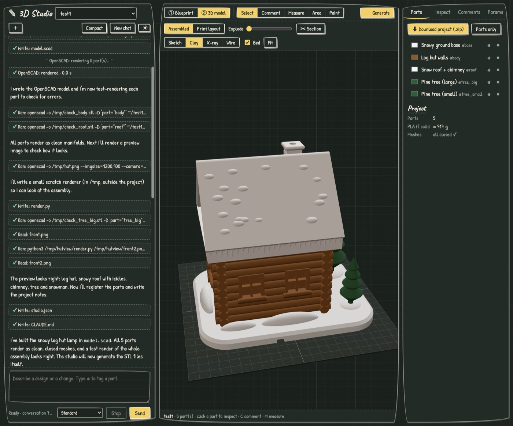
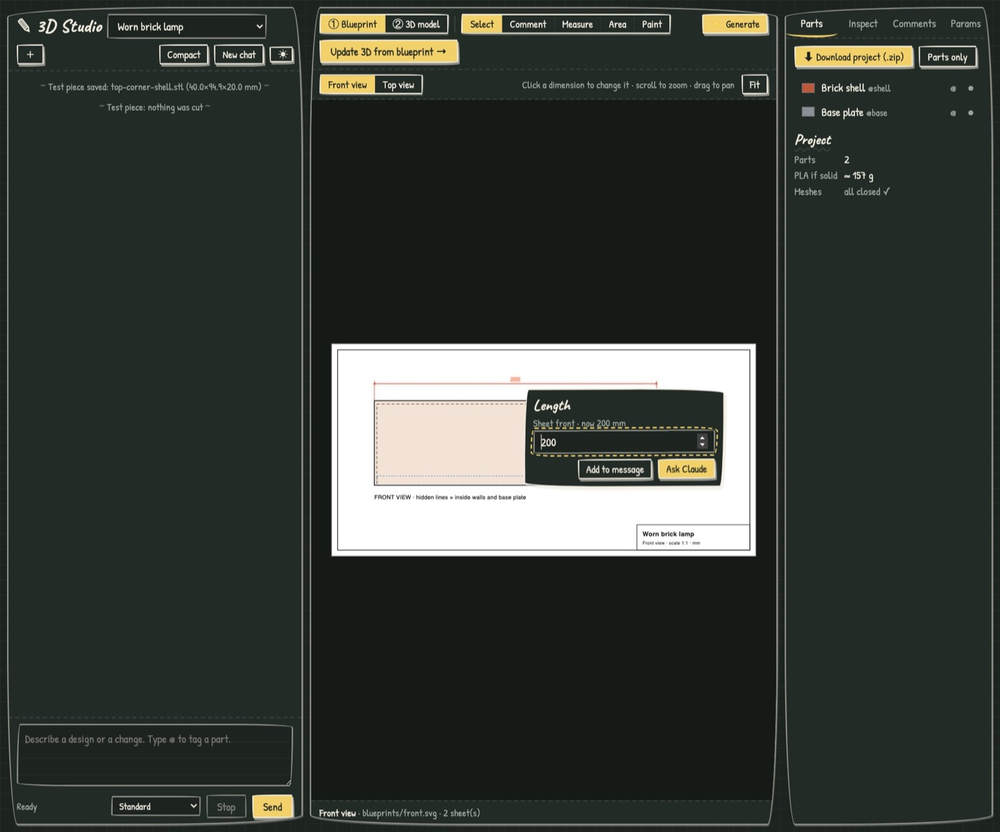
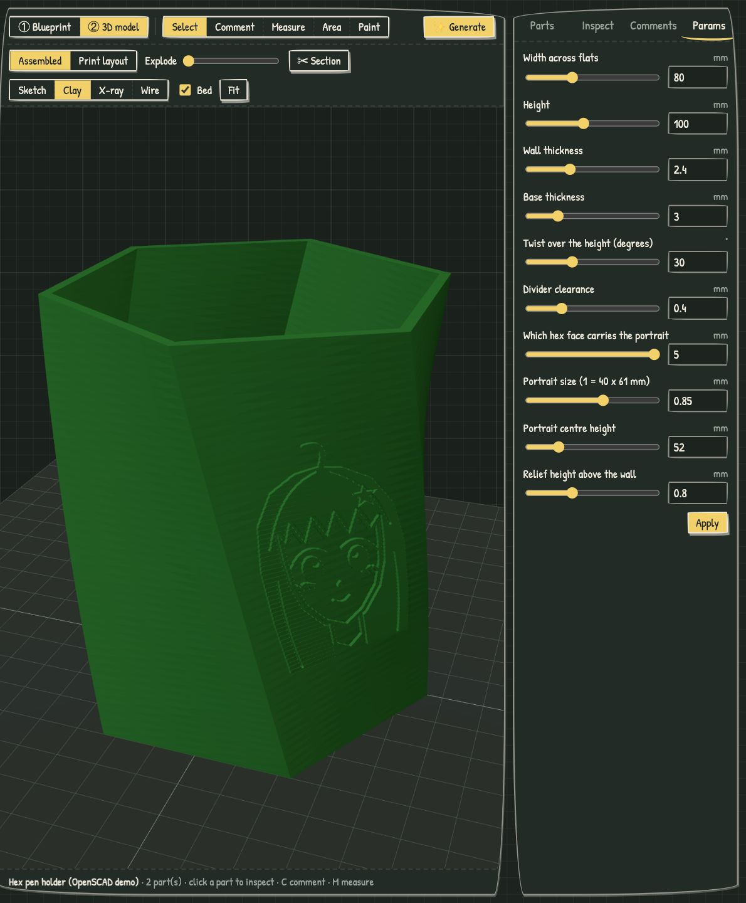
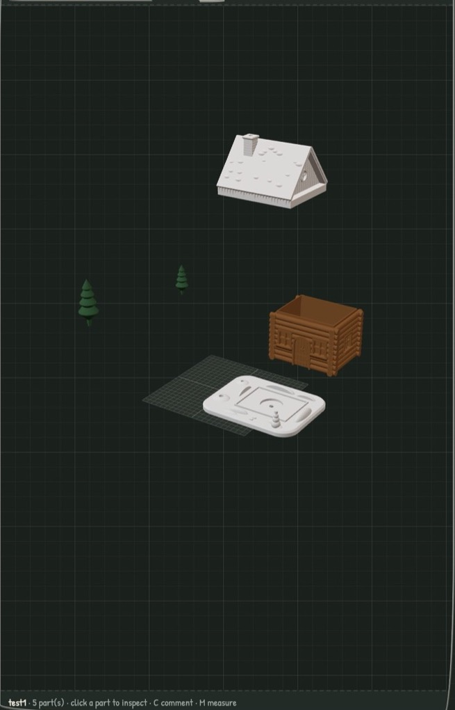
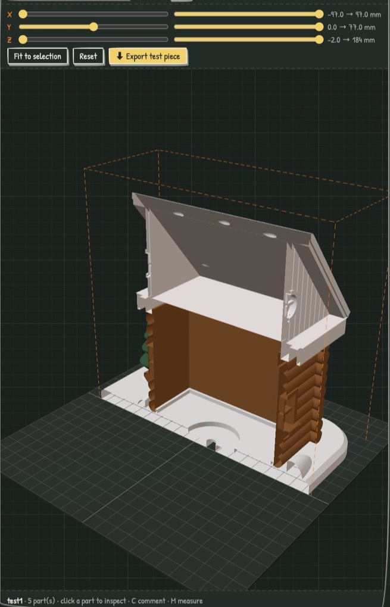
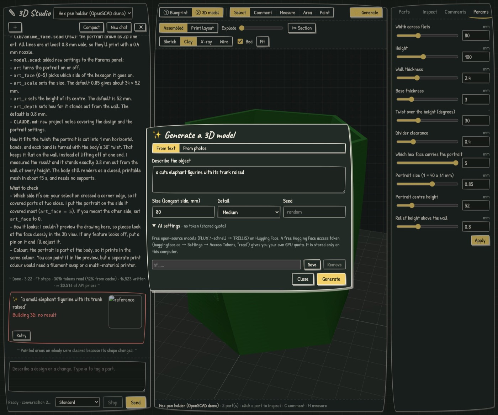

# 3D Studio

Design **3D-printable objects** by chatting with Claude. Runs locally on your own
[Claude Code](https://code.claude.com) login, with no API key.
**[Website](https://pradhuman2022.github.io/3d-studio/)**



## Features

- **Chat to design.** Claude writes real CAD (OpenSCAD), and every part re-renders when the model changes.
- **Blueprint first.** Dimensioned front, top and side drawings. Click a dimension to change it, then convert to 3D.
- **Point at things.** `@tag` parts, pin comments, drag an area, measure two points.
- **Sliders.** Model sizes become sliders that re-render instantly, without another AI turn.
- **Inspect.** Explode the parts, cut a section, x-ray, print layout, paint colours.
- **Print checks.** Closed mesh, fits the bed, estimated filament.
- **✨ Generate.** Text or photos → 3D figurine, scaled and ready to print (free open models).
- **Export.** STL, GLB, or the whole project as a zip.

| Blueprint | Parameters |
|---|---|
|  |  |

| Explode | Section |
|---|---|
|  |  |



## Quick start

You need **Node.js 18+**, **Python 3** and **Claude Code** (logged in, `claude` on your PATH).

```bash
git clone https://github.com/pradhuman2022/3d-studio.git
cd 3d-studio
npm install      # optional: bundled OpenSCAD engine + AI generation client
npm start        # → http://localhost:4317
```

Projects live in the folder above `3d-studio` (set `STUDIO_WORKSPACE` to change it).
Try the demo project `hex_pen_holder`.

**AI generation (optional):** add a free Hugging Face token (type "read") in ✨ Generate → AI settings,
or set `HF_TOKEN`. It is saved only in `.secrets.json` (git-ignored) and is never sent to the browser.

## Settings

| Variable | Default | |
|---|---|---|
| `STUDIO_PORT` | `4317` | Port |
| `STUDIO_BED` | `220x220x250` | Printer volume in mm |
| `STUDIO_MODEL` | Claude Code default | e.g. `opus`, `sonnet` |
| `HF_TOKEN` | — | Hugging Face token for ✨ Generate |

More options, the project format and how it works: [docs/REFERENCE.md](docs/REFERENCE.md).

## Security

- Listens on `127.0.0.1` only and rejects requests from other websites.
- Claude can only edit files in the workspace and run `python3`, `openscad` and a few read-only commands.
  `python3` can run any code, so only open projects you trust.
- Uses **your** Claude Code login, which is for personal use. To host it for others, switch to the
  Claude Agent SDK with an API key.

## License

MIT. OpenSCAD (GPL) runs as a separate program. Generated models follow their model licences
(FLUX.1-schnell: Apache-2.0, TRELLIS: MIT).
